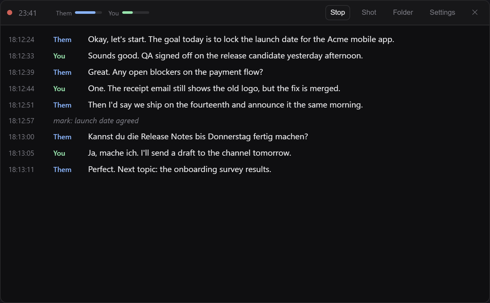
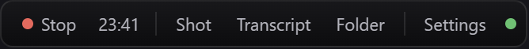
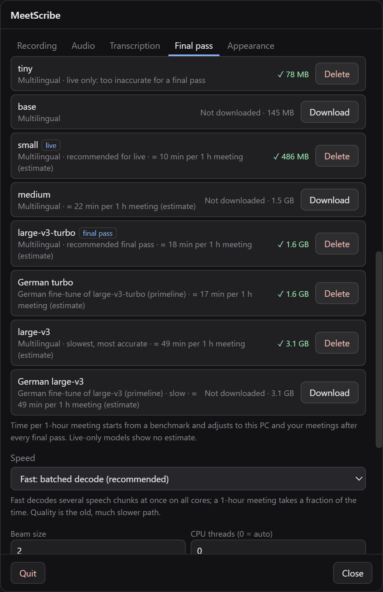
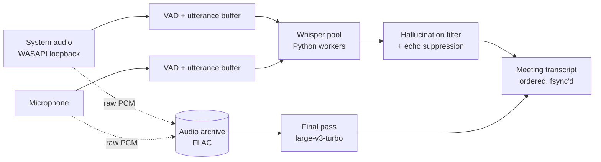

<div align="center">

# MeetScribe

**Private meeting transcripts that never leave your PC.**

A live, speaker-labeled transcript in an overlay that screen sharing can't see, then a high-quality final pass when the meeting ends. No cloud, no API keys, no account.

[](https://github.com/AmineChr54/MeetScribe/releases/latest)
[](https://github.com/AmineChr54/MeetScribe/actions/workflows/ci.yml)
[](https://github.com/AmineChr54/MeetScribe/releases)

[](LICENSE)
[](https://github.com/AmineChr54/MeetScribe/labels/good%20first%20issue)

**[Download](https://github.com/AmineChr54/MeetScribe/releases/latest)** · [How it works](#how-it-works) · [Models](#models-and-speed) · [Contribute](CONTRIBUTING.md) · [Roadmap](https://github.com/AmineChr54/MeetScribe/issues/15)

<br>



 &nbsp; 

<sub>All screenshots use an invented meeting.</sub>

</div>

## Why MeetScribe

- **Nothing leaves your machine.** Audio and transcripts stay on your disk. After the one-time model download, MeetScribe works offline.
- **You know who said what.** Other people's audio (system output) is **Them**, your microphone is **You**. No speaker-diarization guesswork.
- **Nobody sees it.** The overlay is excluded from screen sharing and recordings, and can be made click-through so it never gets in the way.
- **The transcript that counts is the second one.** When the meeting ends, a bigger model re-transcribes the archived audio on all CPU cores, with paragraphs, chapters and the unsure words marked.

## Install

1. Install **Python 3.11, 3.12 or 3.13** from [python.org](https://www.python.org/downloads/) and tick **Add Python to PATH**.
2. Download **[`MeetScribe-Setup-<version>.exe`](https://github.com/AmineChr54/MeetScribe/releases/latest)** and run it. It installs per-user, no admin prompt.
3. Open **Settings** (`Ctrl + ,`) → **Transcription** → **Install / Repair Whisper**. Tick **with CUDA** if you have an NVIDIA GPU.

Step 3 creates a private Python environment and downloads the models into `%APPDATA%\MeetScribe` (a few minutes, internet needed once). Then press `Alt + R` to record.

The build is unsigned, so SmartScreen warns on first run: **More info → Run anyway**. Installed copies check GitHub for updates on launch; you can turn that off in Settings.

<details>
<summary><b>Portable copy</b></summary>

Download `MeetScribe.<version>.exe` from the same release and run it from anywhere. It doesn't install anything and keeps its data in `%APPDATA%\MeetScribe` like the installed app. You still need Python and step 3.
</details>

<details>
<summary><b>Build from source</b></summary>

Needs Node.js 20+ and Python 3.11 to 3.13.

```bash
git clone https://github.com/AmineChr54/MeetScribe.git
cd MeetScribe
npm install
npm run setup:whisper   # venv + model, same as step 3
npm start               # or npm run dev (adds --no-sandbox)
npm run build:win       # installer and portable exe in dist/
npm run deploy          # build and silently install over your local copy
```

`npm run deploy` installs per-user to `%LOCALAPPDATA%\Programs\MeetScribe` and keeps your settings and Whisper setup.
</details>

## What you get after a meeting

Every meeting gets its own folder under `Documents\MeetingTranscripts`:

```
2026-10-23_14-00/
  transcript.txt          live transcript, written line by line as it happens
  transcript.final.md     the final pass: paragraphs, 5-minute chapters, unsure words marked
  transcript.final.json   the same, with word timings and confidence
  shot-01_14-12-05.png    screenshots you took (Ctrl+Shift+S), placed in the transcript
  audio/system.flac       the raw audio of each side, so you can re-run the final pass later
  audio/mic.flac
  meta.json, glossary and corrections used for this meeting
```

The live transcript is synced to disk line by line, so a crash costs seconds, not the meeting. Final passes queue up, survive a restart, and run below normal priority so your PC stays usable.

## Features

<table>
  <tr>
    <td width="50%" valign="top">

**Live transcript.** [faster-whisper](https://github.com/SYSTRAN/faster-whisper) transcribes each side as you talk. Voice detection splits utterances, a filter drops Whisper's stock hallucinations ("Thanks for watching"), and echo suppression stops your speakers from showing up as **You**.

**Stealth overlay.** A slim bar and a transcript panel, always on top, hidden from screen sharing. `Alt + A` makes them click-through; `Ctrl + Shift + V` hides them entirely.

**Markers and screenshots.** Drop a marker (`Ctrl + Shift + M`) at a decision, or grab a screenshot. Both land at the right moment in the live and final transcripts.

**Any language.** Language detection is automatic. English and German work well, and there are German fine-tuned models for the final pass.

  </td>
    <td width="50%" valign="top">

**Final pass.** Re-transcribes the archived audio with `large-v3-turbo` (or a model you pick), batched across all CPU cores. Fast mode does a 1-hour meeting in roughly 15 to 20 minutes on a modern desktop CPU, and a quality mode is there when time doesn't matter.

**Glossary and corrections.** Teach it your product names and jargon so they're spelled right, and fix words it keeps mishearing with a `corrections.json` (`{ "heard": "correct" }`) in `%APPDATA%\MeetScribe`.

**Model manager.** See which models are downloaded and how much space they take, download or delete them, and see how long each would take for a 1-hour meeting. The estimate learns from your own meetings.

**Your audio, your choice.** Pick the loopback or a named output device and microphone, keep the archive as FLAC, WAV or nothing, and choose where meetings are saved.

  </td>
  </tr>
</table>

<details>
<summary><b>Keyboard shortcuts</b></summary>

| Shortcut | Action |
|---|---|
| `Alt + R` or `Ctrl + Shift + R` | Start or stop recording |
| `Ctrl + Shift + S` | Screenshot into the meeting folder |
| `Ctrl + Shift + M` | Add a marker |
| `Ctrl + Shift + T` | Show or hide the transcript panel |
| `Ctrl + Shift + O` | Open the meeting folder |
| `Alt + A` or `Ctrl + Shift + I` | Toggle click-through (the green dot on the bar) |
| `Ctrl + Shift + V` | Hide or show the overlay |
| `Ctrl + Arrow keys` | Move the overlay |
| `Ctrl + ,` | Settings |
</details>

## Models and speed

Pick models in **Settings → Final pass**, where you can also download and delete them. Times are for the fast mode on a 12-core desktop CPU with no GPU, and the app replaces them with times learned on your PC.

| Model | Size | Use | ≈ time per 1 h meeting |
|---|---|---|---|
| `small` | 0.5 GB | live transcript (default) | 10 min |
| `large-v3-turbo` | 1.6 GB | final pass (default), multilingual | 16 to 19 min |
| German turbo | 1.6 GB | final pass, German fine-tune | 17 min |
| `medium` | 1.5 GB | final pass | 22 min |
| `large-v3`, German large-v3 | 3.1 GB | slowest, most accurate | ~50 min |

`tiny` and `base` are there for slow machines (live only). Any other CTranslate2 Whisper model works too: enter its Hugging Face id as a custom model.

## How it works

The audio of each side is captured in the app, split into utterances by voice detection, and sent to a small pool of Python faster-whisper workers. Lines are put back in order by when they were spoken and appended to the meeting folder. In parallel, the raw audio goes into an archive that the final pass re-transcribes when you stop.

<details>
<summary><b>Pipeline diagram</b></summary>



See [docs/ARCHITECTURE.md](docs/ARCHITECTURE.md) for the full tour.
</details>

<details>
<summary><b>Project layout</b></summary>

```
main.js, preload.js        Electron main process, IPC, context-isolated bridge
src/core/                  config defaults, settings store, logger
src/managers/              window management (overlay, click-through, stealth)
src/services/              capture, transcription, whisper pool/workers,
                           meeting files, audio archive, final pass, models
src/ui/                    renderer scripts (audio engine, overlay, settings)
scripts/                   launcher, whisper setup, Python workers
tests/                     unit tests (npm test)
docs/                      architecture and background
.claude/                   shared AI-assisted workflow (agents, commands, hooks)
```
</details>

## Contributing

**Contributors are very welcome.** Issues labeled [`good first issue`](https://github.com/AmineChr54/MeetScribe/labels/good%20first%20issue) and [`help wanted`](https://github.com/AmineChr54/MeetScribe/labels/help%20wanted) come with context, acceptance criteria and pointers to the right files. The [roadmap issue](https://github.com/AmineChr54/MeetScribe/issues/15) is a good place to start.

1. Pick an issue and comment that you're on it.
2. Branch, change, and run `npm run check` and `npm test`.
3. Open a PR using the template.

Read [CONTRIBUTING.md](CONTRIBUTING.md) first. The repo ships a ready-made [Claude Code](https://claude.com/claude-code) setup (`CLAUDE.md`, subagents, slash commands) for AI-assisted contributions; other agents, see [AGENTS.md](AGENTS.md).

> **Privacy rule:** never commit transcripts, audio, screenshots of real meetings or API keys, and redact names in bug reports.

## Good to know

- **Platform:** Windows 10/11 x64 today. [Linux](https://github.com/AmineChr54/MeetScribe/issues/9) and [macOS](https://github.com/AmineChr54/MeetScribe/issues/10) need system-audio capture and are open for help.
- **Python 3.14 isn't supported yet:** `ctranslate2` has no wheels for it. ffmpeg is not needed.
- **Recording consent:** check that everyone in the meeting is fine with being transcribed. Rules differ by country and company.
- **Uninstall** from *Add or remove programs*. Delete `%APPDATA%\MeetScribe` to also remove the Python environment and models.
- **Credits:** MeetScribe started as a fork of [OpenCluely](https://github.com/TechyCSR/OpenCluely) by TechyCSR and was rebuilt around local transcription. See [docs/ABOUT.md](docs/ABOUT.md) and [NOTICE](NOTICE).

## License

Apache License 2.0, see [LICENSE](LICENSE). Security reports: [SECURITY.md](SECURITY.md).
